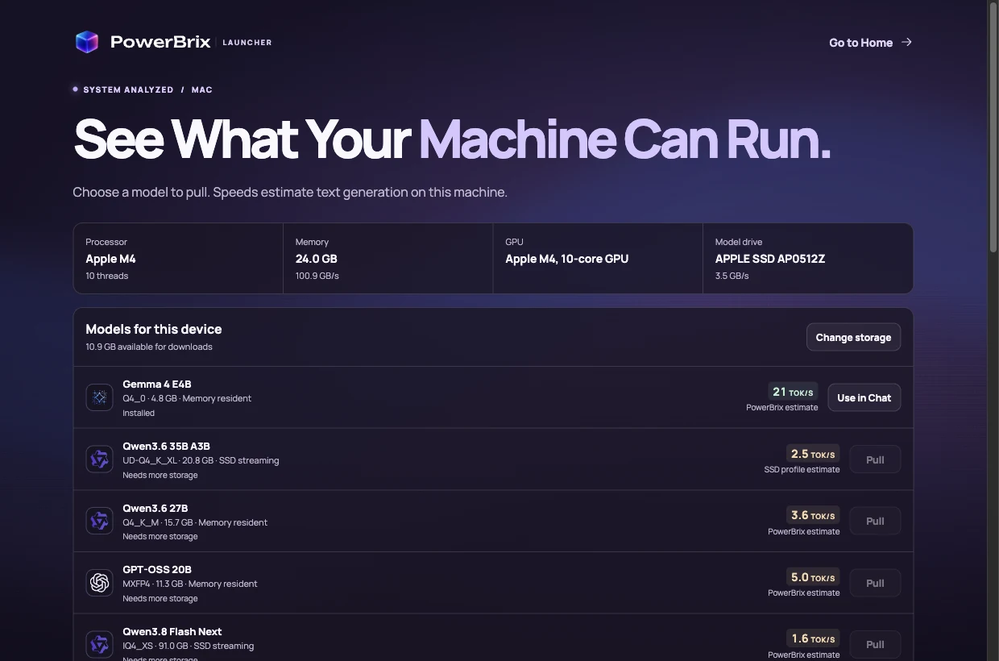
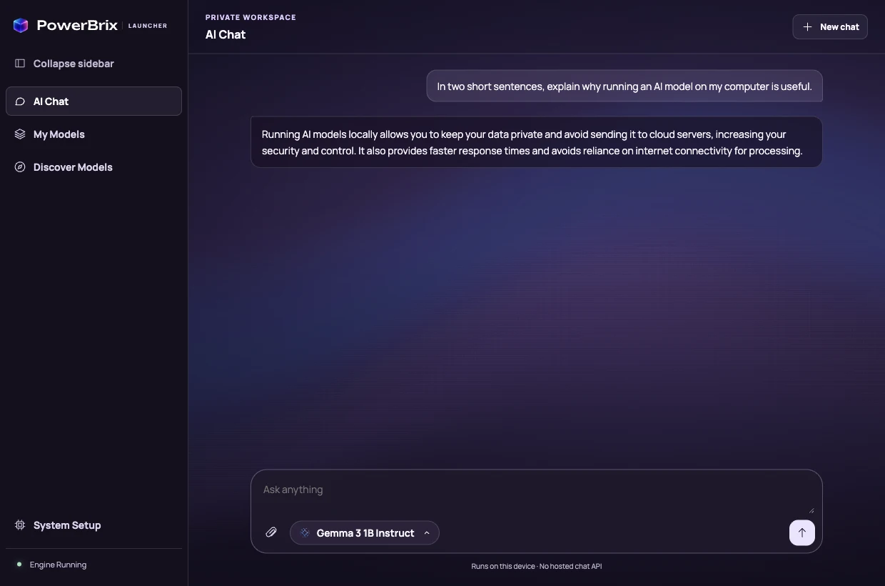

<div align="center">
  
  <br>
  <picture>
    <source media="(prefers-color-scheme: dark)" srcset="renderer/powerbrix-wordmark.svg">
    
  </picture>
  <br>
  <a href="https://powerbrix.ai/">PowerBrix.ai</a>
</div>

# PowerBrix Launcher

**Download and chat with local AI models, including supported models larger than your GPU memory.**

PowerBrix Launcher is a desktop app for Apple Silicon Macs and Windows x64 PCs. Scan your hardware, compare local models, and download the ones you want to run. Inference runs on your device. For compatible models, you can also attach text, PDFs with selectable text, and Word documents directly in chat.

[Download PowerBrix Launcher](https://github.com/automatewithmarko/PowerBrix-Launcher/releases/latest) · [See supported models](#supported-models) · [Build from source](#build-from-source)

| Analyze your hardware | Chat on your device |
| :---: | :---: |
|  |  |
| Compare the disk footprint and estimated generation speed before pulling a model. | Switch among installed models and chat without a hosted API once the engine and weights are installed. |

## What SSD inference changes

A mixture-of-experts (MoE) model routes each token through a subset of its experts. For selected GGUF models, PowerBrix Launcher streams the expert weights needed for each token from your SSD into bounded RAM or VRAM caches. The whole model doesn’t have to fit inside the GPU all at once.

[LM Studio supports partial GPU offload](https://lmstudio.ai/docs/cli/local-models/load), and [Ollama can split loaded models between the CPU and GPU](https://docs.ollama.com/faq#how-can-i-tell-if-my-model-was-loaded-onto-the-gpu). The difference here is a dedicated SSD streaming path for the MoE builds marked **SSD streaming** below. That matters when the weights still exceed the memory you can allocate across the CPU and GPU.

You still need enough SSD space to store the download, and enough working memory for the parts actively used by the model. SSD speed, cache hits, context length, and hardware affect generation speed. The app displays estimates for the selected hardware and drive, and ordinary models run through the memory-resident path.

## Supported models

<p>
   &nbsp;  &nbsp; <picture><source media="(prefers-color-scheme: dark)" srcset="renderer/model-logos/openai.svg"></picture> &nbsp;  &nbsp;  &nbsp;  &nbsp;  &nbsp;  &nbsp; <picture><source media="(prefers-color-scheme: dark)" srcset="renderer/model-logos/kimi.svg"></picture> &nbsp; <strong>(uncensored versions too)</strong>
</p>

Disk sizes are approximate for the specific quantization PowerBrix pulls. Each name links to the repository hosting those weights.

| Model | Quantization | Approx. weights | Runtime |
| --- | --- | ---: | --- |
| [Gemma 4 E4B](https://huggingface.co/google/gemma-4-E4B-it-qat-q4_0-gguf) | Q4_0 | 4.80 GiB | Memory resident |
| [Qwen3.6 35B A3B](https://huggingface.co/unsloth/Qwen3.6-35B-A3B-GGUF) | UD-Q4_K_XL | 20.82 GiB | SSD streaming |
| [Qwen3.6 27B](https://huggingface.co/unsloth/Qwen3.6-27B-GGUF) | Q4_K_M | 15.66 GiB | Memory resident |
| [GPT-OSS 20B](https://huggingface.co/ggml-org/gpt-oss-20b-GGUF) | MXFP4 | 11.28 GiB | Memory resident |
| [Qwen3.8 Flash Next](https://huggingface.co/bartowski/Qwen3.8-Flash-Next-GGUF) | IQ4_XS | 90.97 GiB | SSD streaming |
| [DeepSeek V4.1 Flash](https://huggingface.co/mrfakename/DeepSeek-V4.1-Flash-1017-GGUF) | Q8_0 | 473.07 GiB | SSD streaming |
| [Muse Spark Open](https://huggingface.co/unsloth/Muse-Spark-Open-816B-A42B-GGUF) | UD-Q4_K_XL | 470.79 GiB | SSD streaming |
| [Gemma 3 1B Instruct](https://huggingface.co/ggml-org/gemma-3-1b-it-GGUF) | Q4_K_M | 0.75 GiB | Memory resident |
| [Llama 3.2 3B Instruct](https://huggingface.co/unsloth/Llama-3.2-3B-Instruct-GGUF) | Q4_K_M | 1.88 GiB | Memory resident |
| [Phi-4 Mini Instruct](https://huggingface.co/bartowski/microsoft_Phi-4-mini-instruct-GGUF) | Q4_K_M | 2.32 GiB | Memory resident |
| [Mistral 7B Instruct v0.3](https://huggingface.co/bartowski/Mistral-7B-Instruct-v0.3-GGUF) | Q4_K_M | 4.07 GiB | Memory resident |
| [Qwen2.5 Coder 7B Instruct](https://huggingface.co/Qwen/Qwen2.5-Coder-7B-Instruct-GGUF) | Q4_K_M | 4.36 GiB | Memory resident |
| [DeepSeek R1 Distill Qwen 7B](https://huggingface.co/unsloth/DeepSeek-R1-Distill-Qwen-7B-GGUF) | Q4_K_M | 4.36 GiB | Memory resident |
| [IBM Granite 3.3 8B Instruct](https://huggingface.co/ibm-granite/granite-3.3-8b-instruct-GGUF) | Q4_K_M | 4.60 GiB | Memory resident |
| [Qwen3 8B](https://huggingface.co/Qwen/Qwen3-8B-GGUF) | Q4_K_M | 4.68 GiB | Memory resident |
| [Huihui Qwen3 0.6B v2](https://huggingface.co/mradermacher/Huihui-Qwen3-0.6B-abliterated-v2-GGUF) · Abliterated | Q4_K_M | 0.37 GiB | Memory resident |
| [mLabonne Qwen3 1.7B](https://huggingface.co/bartowski/mlabonne_Qwen3-1.7B-abliterated-GGUF) · Abliterated | Q4_K_M | 1.03 GiB | Memory resident |
| [Lexi Llama 3.1 8B](https://huggingface.co/bartowski/Llama-3.1-8B-Lexi-Uncensored-GGUF) · Uncensored | Q4_K_M | 4.58 GiB | Memory resident |
| [Dolphin 3.0 Llama 3.1 8B](https://huggingface.co/bartowski/Dolphin3.0-Llama3.1-8B-GGUF) · Uncensored | Q4_K_M | 4.58 GiB | Memory resident |
| [Huihui Qwen3 14B](https://huggingface.co/bartowski/huihui-ai_Qwen3-14B-abliterated-GGUF) · Abliterated | Q4_K_M | 8.38 GiB | Memory resident |
| [Kimi K3.1 Pro](https://huggingface.co/DevQuasar/moonshotai.Kimi-K3.1-Pro-GGUF) | Q2_K | 940.00 GiB | CPU / SSD mapping |
| [Kimi K3](https://huggingface.co/unsloth/Kimi-K3-GGUF) | UD-Q2_K_XL | 802.13 GiB | CPU / SSD mapping |
| [Kimi K2.7 Code](https://huggingface.co/unsloth/Kimi-K2.7-Code-GGUF) | UD-Q2_K_XL | 316.15 GiB | CPU / SSD mapping |
| [Kimi K2.6](https://huggingface.co/unsloth/Kimi-K2.6-GGUF) | UD-Q2_K_XL | 317.09 GiB | CPU / SSD mapping |
| [Kimi K2.5](https://huggingface.co/unsloth/Kimi-K2.5-GGUF) | UD-Q2_K_XL | 349.03 GiB | CPU / SSD mapping |
| [Kimi K2 Thinking](https://huggingface.co/unsloth/Kimi-K2-Thinking-GGUF) | UD-Q2_K_XL | 359.81 GiB | CPU / SSD mapping |
| [Kimi K2 Instruct 0905](https://huggingface.co/unsloth/Kimi-K2-Instruct-0905-GGUF) | UD-Q2_K_XL | 357.23 GiB | CPU / SSD mapping |
| [Kimi K2 Instruct](https://huggingface.co/unsloth/Kimi-K2-Instruct-GGUF) | UD-Q2_K_XL | 355.64 GiB | CPU / SSD mapping |
| [Kimi Linear 48B A3B](https://huggingface.co/bartowski/moonshotai_Kimi-Linear-48B-A3B-Instruct-GGUF) | Q4_K_M | 28.00 GiB | CPU / SSD mapping |
| [Kimi Dev 72B](https://huggingface.co/unsloth/Kimi-Dev-72B-GGUF) | UD-Q3_K_XL | 35.67 GiB | CPU / SSD mapping |

Kimi downloads include all split GGUF files. The launcher installs a checksum-verified Kimi engine on first use and uses CPU inference with SSD memory mapping. This path supports systems without a dedicated GPU. The complete download must fit on your SSD, and performance depends on working memory, SSD speed, and model size. Kimi support here is text chat, including skills, web search, and extracted document text. Full Kimi generation runs have not been benchmarked on our test machine.

## Install and update

1. Get the DMG for Apple Silicon macOS or the setup EXE for Windows x64 from [Releases](https://github.com/automatewithmarko/PowerBrix-Launcher/releases/latest).
2. Move the Mac app into Applications, or run the Windows setup.
3. Open the launcher, select **Analyze System**, then pull a model from the results or **Discover Models**.

Install v0.1.7 or later once to get in-app updates. The launcher checks GitHub without an account on startup and, from v0.1.10 onward, every minute while it is open. It verifies downloads against the release checksum and restarts only after you select **Download and restart**. Models, chats, installed plugins, and custom skills (including their enabled states) stay in your user profile when you update.

In **Plugins**, you can enable Chat History, Microphone Typing, Skills, and Internet Search. Microphone Typing downloads its speech model on first use and transcribes on your device. Internet Search sends only the search query to the search provider.

The Mac app is signed locally and has not been notarized. The Windows installer is unsigned. The Windows build and installer contents are verified during packaging; live Windows inference and updating need hardware validation.

## Build from source

Use Node.js 22.12+ and npm.

```sh
npm ci
npm start
npm test
```

Installer builds compile the bundled speech tool with CMake and a C++ compiler. Use Ninja on macOS and Visual Studio Build Tools when building on Windows. Install `dmgbuild` with `pipx install dmgbuild==2.0.0`, then run `npm run package:mac` on macOS to make a DMG. Run `npm run package:win` with `makensis` on the path to build the Windows setup. Both scripts write to `build/`.

### Ship an update

On `main`, edit [new-update.json](new-update.json) with a higher three-part version and a short name, then push. The [release workflow](.github/workflows/launcher-release.yml) synchronizes the package version in the builds, tests and packages both platforms, and publishes the installers, source bundle, and update manifest together. It runs on the public repository; ordinary code pushes that don’t change `new-update.json` do not start a release.

## License

PowerBrix Launcher’s own code and app are licensed for personal, non-commercial use. See [LICENSE](LICENSE). Third-party components and downloaded models keep their own terms. Brand marks belong to their respective owners.
